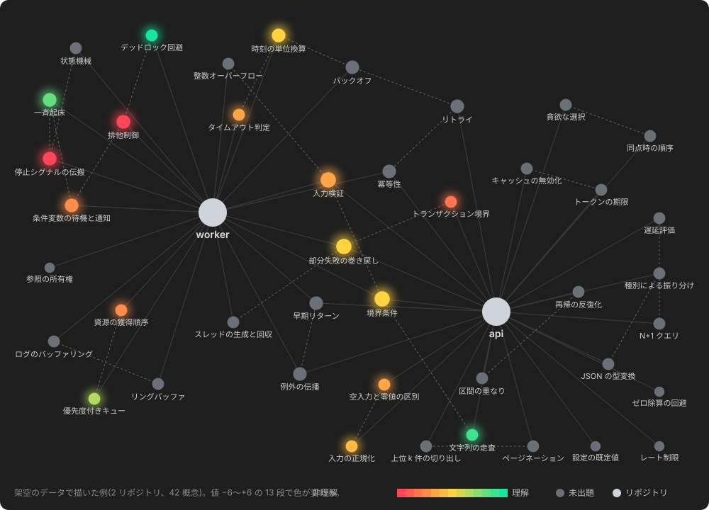

# hidane 🔥

[English](README.md)

Claude に、自分がコードのどこを理解していて、どこを理解していないかを伝えるための道具。

AI にコードを書かせると、動くものは増えるのに、自分が説明できる範囲は増えない。そして Claude は、こちらが何を分かっていないかを知らないまま解説する。
hidane は自己申告ではなく、一問ずつ答えた記録から「理解の地図」を作る。Claude は解説の前にその地図を読み、知っていることは飛ばし、前に間違えた所から話す。
同じ地図を自分も見る。点数ではなく、どの概念が灯っているか。

<p align="center">
  
</p>

## 何が起きるか

commit するたび、触った関数に「概念」が付く(境界条件、部分失敗の巻き戻し、条件変数の待機と通知、など)。
Claude Code で `/hidane` と打つと、その中から関数が 1 つ選ばれ、一問だけ出る。

```
src/main.c:19 is_valid_num
引数に文字列 "+5" を渡したとき、この関数は何を返しますか。
答えに含めるもの: 返り値 1、分岐 1
```

自分の言葉で答える。「分からない」も答え。

```
当たり(鍵 2 / 2)
| 2026-09-09 09:54 | src/main.c:19-33 | is_valid_num | 入力検証, 境界条件 | trace | "+5" を渡すと何を返す | hit |  |  |
```

正解の要素は答える前に 2〜5 個「鍵」として固定されていて、鍵ごとに ある / ない / 逆 を判定する。問いの最後の行は鍵の種類と数で、中身は出ない。鍵にした事実は全部、その行で答える範囲に入っている。
足りなければ「部分(鍵 3 / 4)、触れていない: 順序 L28-29」と種類と行番号だけ返る。中身は教えない。読みに行く。読んでも分からなければ `/hidane さっきの問いで触れていなかった所` と聞けば、そこから解説が出る。
解説も総括も出ない。それが問う側の流儀。

答えが溜まると Obsidian の Graph view で概念に色が付く。色は概念ごとの「値」で決まる。当たりで上がり、ズレと「分からない」で下がる。

| 色 | 状態 | いつそうなるか |
|---|---|---|
| 消灯 | 未出題 | その概念の関数がまだ一度も問われていない |
| 黄 | 曖昧 | 答えたが決着していない。当たりとズレが混ざる、まだ 1〜2 問、または 30 日答えていない |
| 青緑 | 理解 | 当たりが積み重なった(値が +4 以上) |
| 赤 | 非理解 | ズレが積み重なった(値が −4 以下) |

1 問で動く幅は問いの型で違う。追う問い 1、境界を突く問い 2、要約 3。部分は動かさない。解説を読んでも動かない。
30 日答えないと理解も非理解も黄に戻り、答えれば戻る。最初はほぼ全部が消えていて、答えるたびに 1 つずつ灯る。

解説が欲しいときは `/hidane printf って何？` のように、`/hidane` に続けて聞く。Claude は先に地図を読む。
理解している概念は名前も出さず、非理解の概念は前に間違えた所から丁寧に、自分の関数を例にして話す。
printf のように地図に無いものは、その場で近い概念に結びつける。解説の冒頭には「地図から: 非理解 …、飛ばした概念: …」の 2 行が付くので、何を読んで何を変えたかが見える。
解説を読んでも色は変わらない。読んだことは理解の証拠ではないから。

`/hidane --weak` は、その解説を自分の弱い所に向けたもの。過去のズレを全部並べて 1 つの型にまとめ、追うべき流れを段に分けて、どの段で躓いているかを自分のコードの行で示す。

```
地図から: 非理解 停止フラグの伝搬, 条件変数の一斉起床 → ここから書く。曖昧 タイムアウト判定。過去のズレ 3 件を使った
飛ばした概念: なし

ズレの型: 「停止後も 1 行出る」「wake_all の書き忘れ」「残りの worker のログも止まる。wake_all と return 1 に触れず」。
3 件とも、stopped = 1 を立てた所で話が終わっている。立てても誰も止まらない。
止まるのは、各スレッドが自分でフラグを読みに来たときだけ。

流れ: 1 立てる(src/stop.c:30-35) → 2 起こす(src/stop.c:41-53) → 3 起きた側が自分で読む(src/slot.c:58) → 4 後片付けして抜ける(src/slot.c:56-65)
ズレは 2 段目と 4 段目。
```

この 1 枚は地図が無いと書けない。どのズレを型にまとめるかも、流れのどの段を丁寧に書くかも、記録から決まる。

## 試す

git、[Claude Code](https://claude.com/claude-code)、できれば [Obsidian](https://obsidian.md)。

```sh
git clone git@github.com:kanaharu20/hidane.git ~/hidane
cd 使いたいリポジトリ && sh ~/hidane/install.sh
```

言語(en / ja)を聞かれ、`/hidane` が登録され、このリポジトリに hook が置かれ、全関数に概念が付き(8 関数ごとに 1 分前後。50 関数なら 6〜7 分待つ)、
地図が `~/Documents/hidane` にできる。Obsidian でそのフォルダを「Open folder as vault」で開く。あとは `/hidane`。

| | |
|---|---|
| `/hidane` | 一問 |
| `/hidane <聞きたいこと>` | 自分に合わせた解説。関数でも概念でも printf でも、「自分の弱い所は」でも |
| `/hidane --weak` | 弱い所を 1 枚に。ズレを型にまとめ、流れのどの段で躓いているかを自分のコードの行で示す |
| `/hidane --map` | 概念ごとの値と状態の表 |
| `/hidane --vault` | 地図を作り直して Obsidian で開く |
| `/hidane --lint` | 似た概念名を統合(3 日に一度は自動) |
| `/hidane --tag` | まだ地図に無い関数に概念を付ける(背景で。commit 前でも)。commit 時は hook が自動 |
| `/hidane --update` | 最新版にして記録を移行 |
| `/hidane --help` | 使い方 |

commit のとき、触った関数のソースが自分の Claude(`claude -p`)に送られて概念名が返る。hook はそのたびに 1 行出すので黙って動くことはない。
`HIDANE_HOOK_OFF=1` か `install.sh --unhook` で止まる。記録と地図は手元にだけある。費用は自分の Claude Code の範囲で、40 関数なら最初のタグ付けが 5 回前後。

詳しい手順と困ったときの対処は [docs/GUIDE.ja.md](docs/GUIDE.ja.md)。

## 決めていること

点数を出さない。点数は興味を下げ、注意をコードから自分に向ける(Butler 1988、Kluger & DeNisi 1996)。色は「このコードのどこが灯っているか」であって、成績ではない。

記録は追記だけ。値も状態も保存せず、毎回 `log.md` から計算する。概念名の統合も別名で行い、元の行は書き換えない。地図は消しても作り直せる。

LLM に判断させるのは 3 か所だけ。関数にどの概念を付けるか、どの概念名が同じ意味か、解説の粒度。
前の 2 つは既存の一覧から選ばせ、形式はスクリプトが検査する。当たりかどうか、次に何を問うか、問いの型は、全部スクリプトが決める。
前身の reflect で、Claude に任せた判断と文面の指示は同じ入力でもぶれた。だから決めるのはスクリプト、Claude が埋めるのは穴だけにした。

「まだ問うていない」と「問うて分からなかった」は別の状態。混ぜない。問いは後者から出す。

概念はその人に属し、関数はリポジトリに属する。A で分からなかった概念は、B の commit で最初に問われる。

仕組みの細部は [docs/DESIGN.ja.md](docs/DESIGN.ja.md)。

## できないこと、まだのこと

- 作者 1 人が 2 リポジトリで 32 問答えた段階。重み(1 / 2 / 3)、閾値(±4)、忘却(30 日)は全部仮置き
- 「何をするか」型の問い(summary)の判定は、まだ Claude の読みに頼っている。説明からコードを生成して照合する方式(CGBG)は入れていない
- 依存を git と POSIX sh だけにした代わりに、sh と awk が密で読みにくい。181 件の検査がそれを支えている
- Linux は動くはずだが未検証。`/hidane --vault` は macOS の `open` を使う
- Claude が SKILL の手順をどこまで守るかは、実走の会話記録で確かめている。文面の指示は効かないことがある

## 開発

```sh
sh tests/run_all.sh     # 181 件。LLM は呼ばない。数秒
```

新しい検査は、実装を壊して落ちるのを見てから信じる。`run_all.sh` は検査の数がこの README とずれると落ちる。

| ファイル | 一言 |
|---|---|
| `hooks/post-commit` | commit 後に tag.sh を背景で呼ぶ。commit は止めない |
| `scripts/scope.sh` | リポジトリを関数単位に切って候補を出す |
| `scripts/tag.sh` | 関数に概念を付けて functions.md に追記する(LLM を呼ぶ 1 か所目) |
| `scripts/map.sh` | log.md から概念ごとの値と状態を毎回計算する |
| `scripts/next.sh` | 次に問う関数を 1 つ選び、pending に書く |
| `scripts/keys.sh` | 答えを聞く前に正解の要素(鍵)を固定し、「答えに含めるもの」の行を出す |
| `scripts/record.sh` | 鍵の判定から結果を決めて log.md に 1 行追記する(一次記録の唯一の書き口) |
| `scripts/resolve.sh` | 読むときに概念名を aliases.md で新名に置き換えるフィルタ |
| `scripts/pages.sh` | 地図(Obsidian の vault)を記録から作り直す |
| `scripts/open.sh` | 地図を作り直して Obsidian で開く |
| `scripts/lint.sh` | 似た概念名を統合して aliases.md に書く(LLM を呼ぶ 2 か所目) |
| `scripts/weak.sh` | 弱い所の材料(ズレのある概念、ズレ全件、関数)を集める |
| `scripts/explained.sh` | 解説を求めたことを explained.md に 1 行残す |
| `scripts/lang.sh` | ja/en の表示文字列と、記録の置き場の名前の決め方 |
| `scripts/help.sh` | `/hidane --help` の固定文 |
| `scripts/migrate.sh` | 記録の形式が変わったとき古い log.md を直す |
| `scripts/stats.sh` | 名前を出さない数字だけの要約(フィードバック用) |
| `install.sh` | セットアップ、hook の設置と撤去、更新 |
| `tests/run_all.sh` | 全検査を回し、README の検査数と照合する |

| 変数 | 既定 | |
|---|---|---|
| `HIDANE_LANG` | config、無ければ en | 表示とプロンプトの言語 |
| `HIDANE_ROOT` | `~/.claude/hidane` | 記録 |
| `HIDANE_VAULT` | `~/Documents/hidane` | 地図 |
| `HIDANE_W_TRACE` / `_EDGE` / `_SUMMARY` | 1 / 2 / 3 | 型の重み |
| `HIDANE_THRESHOLD` / `HIDANE_CAP` | 4 / 6 | 閾値と上限 |
| `HIDANE_FRESH_DAYS` | 30 | 忘却 |
| `HIDANE_MAX_FUNCS` | 8 | 1 回の LLM 呼び出しに載せる関数 |
| `HIDANE_LINT_DAYS` | 3 | lint の間隔 |
| `HIDANE_WEAK_N` | 3 | `--weak` に載せる概念の数 |
| `HIDANE_MODEL` | | `claude -p` に渡す `--model` |
| `HIDANE_HOOK_OFF` | | 1 で hook を止める |
| `HIDANE_SKILL_DIR` | `~/.claude/skills/hidane` | skill の置き場 |
| `HIDANE_CLAUDE` / `HIDANE_OPEN` | claude / open | 検査用の差し替え |

fork や PR、レビューの手引きは [CONTRIBUTING.ja.md](CONTRIBUTING.ja.md)。
reflect(前身)の記録は形が違うので自動では移らない。[docs/MIGRATING-from-reflect.ja.md](docs/MIGRATING-from-reflect.ja.md)。
版は [CHANGELOG.md](CHANGELOG.md)。

## ライセンス

MIT
