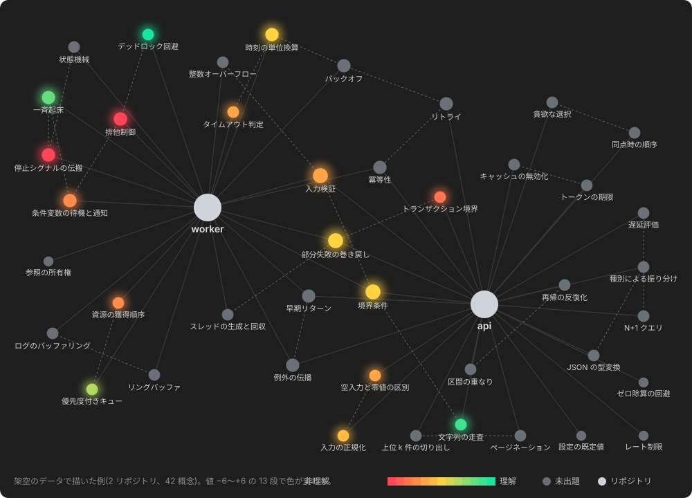

# hidane 🔥

[日本語](README.ja.md)

A map of which parts of your own code you understand and which you have never checked.
Two readers: you, and Claude.

When an AI writes your code, the amount that works grows; the amount you can explain does not.
I wanted that gap visible as colors rather than a score. And if Claude reads the same map, its explanations
land at your level: it skips what you know and starts from what you got wrong last time.

<p align="center">
  
</p>

## What happens

Every commit tags the functions it touched with "concepts" (boundary conditions, rollback on partial failure, condition-variable wait and notify, and so on).
Type `/hidane` in Claude Code and it picks one of those functions and asks exactly one question.

```
src/main.c:19 is_valid_num
Given the string "+5", what does this function return?
```

Answer in your own words. "I don't know" is an answer.

```
hit (keys 2 / 2)
| 2026-09-09 09:54 | src/main.c:19-33 | is_valid_num | input validation, boundary conditions | trace | "+5" → returns? | hit |  |  |
```

The elements of the correct answer were fixed as 2-5 "keys" before you answered, and each key is judged present / missing / contradicted.
Fall short and you get "partial (keys 3 / 4), not mentioned: L28-29", line numbers only. It does not tell you what is there. You go and read.
No explanation, no summary. That is how the asking side behaves.

As answers accumulate, concepts light up in Obsidian's graph view. Understood is green, fuzzy amber, not understood red, never asked stays unlit.
A traffic light. At first almost everything is dark, and it lights up one answer at a time.

When you want an explanation, ask for it: `/hidane --explain printf`. Claude reads the map first.
Concepts you understand are not even named; concepts you do not understand are explained carefully, starting from what you got wrong, using your own functions as examples.
Something outside the map, like printf, gets mapped to the nearest concepts on the spot. The explanation opens with two lines, "From the map: not understood …, skipped: …", so you can see what was read and what it changed.
Reading an explanation changes no color. Reading is not evidence of understanding.

## Try it

git, [Claude Code](https://claude.com/claude-code), and ideally [Obsidian](https://obsidian.md).

```sh
git clone git@github.com:kanaharu20/hidane.git ~/hidane
cd your-repo && sh ~/hidane/install.sh
```

It asks en or ja, registers `/hidane`, adds a hook to this repository, tags every function (about a minute), and writes the map to `~/Documents/hidane`.
Open that folder in Obsidian with "Open folder as vault". Then `/hidane`.

| | |
|---|---|
| `/hidane` | one question |
| `/hidane --explain <topic>` | an explanation at your level: a function, a concept, printf |
| `/hidane --map` | the table of concepts, values and states |
| `/hidane --vault` | rebuild the map and open it in Obsidian |
| `/hidane --lint` | merge concept names that mean the same (also automatic every 3 days) |
| `/hidane --update` | latest version, records migrated |

At commit time the source of the touched functions goes to your own Claude (`claude -p`) and concept names come back. The hook prints one line every time, so it never runs silently.
`HIDANE_HOOK_OFF=1` or `install.sh --unhook` stops it. Records and the map stay on your machine. Cost is on your Claude Code plan; a 40-function repository takes about 5 calls to tag.

The long version, with expected outputs and troubleshooting: [docs/GUIDE.md](docs/GUIDE.md).

## Decisions

No scores. Scores lower interest and turn attention from the code to the self (Butler 1988; Kluger & DeNisi 1996). The colors say which parts of the code are lit, not how good you are.

The record is append-only. Values and states are never stored; everything is recomputed from `log.md`. Merging concept names is done with aliases, never by rewriting rows. Delete the map and it comes back.

The LLM decides three things only: which concepts a function gets, which concept names mean the same, and the level of an explanation.
The first two choose from an existing list and are validated by scripts. Whether an answer was right, what to ask next, and the question type are all decided by scripts.
In the predecessor, judgments left to Claude and instructions given in prose drifted between runs on the same input. So scripts decide, and Claude fills in blanks.

"Never asked" and "asked and failed" are different states and are kept apart. Questions come from the second.

Concepts belong to you; functions belong to a repository. A concept you failed in repo A is the first thing asked when repo B commits.

The mechanics in detail: [docs/DESIGN.md](docs/DESIGN.md).

## Limits, and what is not done

- One author, two repositories, 25 answers so far. Weights (1 / 2 / 3), threshold (±4) and forgetting (30 days) are all provisional
- The "what does this function do" question type (summary) is still judged by Claude reading the answer; grading by generating code from the explanation (CGBG) is not in
- Zero dependencies beyond git and POSIX sh came at the price of dense sh and awk. 135 tests are what make it safe to change
- Linux should work but is untested; `/hidane --vault` uses macOS `open`
- How closely Claude follows the SKILL steps is checked by reading real session transcripts. Prose instructions sometimes do not take

## Development

```sh
sh tests/run_all.sh     # 135 tests, no LLM, seconds
```

A new test is trusted only after breaking the implementation and watching it fail. `run_all.sh` also fails if the test count in this README drifts from reality.

| Variable | Default | |
|---|---|---|
| `HIDANE_LANG` | from config, else en | display and prompt language |
| `HIDANE_ROOT` | `~/.claude/hidane` | records |
| `HIDANE_VAULT` | `~/Documents/hidane` | the map |
| `HIDANE_W_TRACE` / `_EDGE` / `_SUMMARY` | 1 / 2 / 3 | type weights |
| `HIDANE_THRESHOLD` / `HIDANE_CAP` | 4 / 6 | threshold and clamp |
| `HIDANE_FRESH_DAYS` | 30 | forgetting |
| `HIDANE_MAX_FUNCS` | 8 | functions per LLM call |
| `HIDANE_LINT_DAYS` | 3 | lint interval |
| `HIDANE_HOOK_OFF` | | 1 disables the hook |

Records from reflect (the predecessor) have a different shape and are not imported automatically: [docs/MIGRATING-from-reflect.ja.md](docs/MIGRATING-from-reflect.ja.md).
Versions: [CHANGELOG.md](CHANGELOG.md).

## License

MIT
